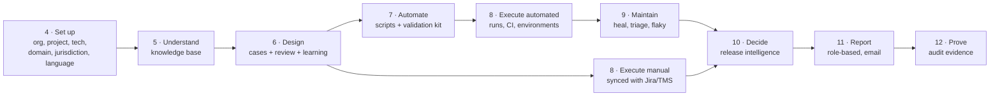
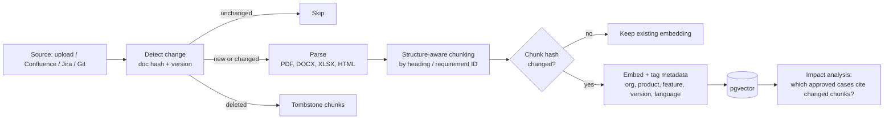
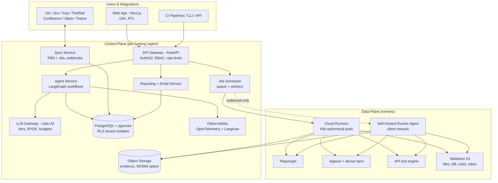
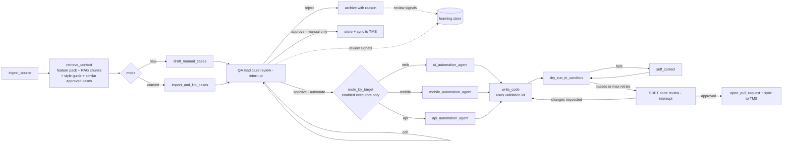
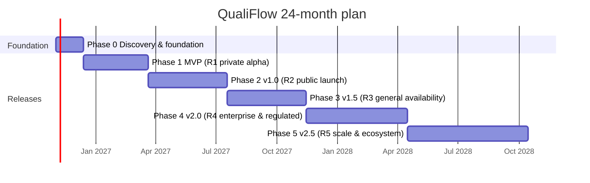

# QualiFlow — AI-Native Test Automation Platform

**Product & Engineering Plan · v2.0 · October 2026**

> *"QualiFlow" is a working name. Check trademark and domain availability before using it publicly.*

**How to read this plan**

- **Part A — Strategy** (§1–3): what we're building, for whom, and the principles behind every decision.
- **Part B — Product** (§4–14): capabilities in the order a test actually lives: set up → understand requirements → design cases → automate → execute → maintain → decide release → report → prove compliance.
- **Part C — Platform** (§15–21): architecture, agents, data, security, operations, quality.
- **Part D — Business** (§22–24): model, legal, go-to-market.
- **Part E — Delivery** (§25–29): what ships when, over a 24-month plan, plus risks and next steps.

Boxes marked **💡 Recommendation** are my suggestions for you to review and accept, change, or reject.

---

# Part A — Strategy

## 1. Executive Summary

QualiFlow is an enterprise-grade, multi-tenant SaaS platform that uses agentic AI (LangGraph) to **design, generate, run, heal, and triage** functional tests across **web UI (Playwright)**, **mobile (Appium)**, and **APIs (Playwright request / RestAssured / pytest)** — and to support **manual testing** in the tools teams already use.

Around that core it adds:

- a **knowledge base** of the client's requirements, kept current with delta ingestion;
- **adaptive generation** that learns each QA team's style from their review decisions;
- **release intelligence** that recommends which tests to run for each release;
- **role-based reporting** from QA engineer to C-level and the client, by dashboard and email;
- **audit-ready evidence** for regulated domains (BFSI, pharmacovigilance, healthcare, insurance), adapted to each client's **jurisdiction** (e.g. Saudi Arabia, USA, EU, India);
- **multilingual** support across the UI, generated content, reports, and testing of localized apps.

The project serves two goals at once:

1. **Portfolio** — a public, well-engineered repo that proves production-grade agentic AI skills (LangGraph, MCP, RAG, evals, observability, multi-tenancy, security).
2. **Product** — a live, paying SaaS, released early as a focused MVP and grown over ~24 months into the full platform described here.

---

## 2. Problem, Users & Positioning

### 2.1 The problem

| Pain | Cost to teams |
|---|---|
| Writing test cases and automation is slow | Coverage lags behind features; manual regression persists |
| Locators break on every UI change | A large share of automation effort goes to maintenance (often cited at 30–50% — validate in customer interviews) |
| Failure investigation is manual | Engineers spend hours deciding "bug, flake, or environment?" |
| Full regression every release is slow; partial regression is guesswork | Late releases or escaped defects |
| Web, mobile, API, and manual testing live in separate tools | Fragmented reporting, duplicated effort |
| Audit evidence is assembled by hand | Weeks of effort per release in regulated domains |

### 2.2 Target users

- **Primary:** QA/SDET teams of 3–30 people in mid-size product companies and IT services firms.
- **Secondary:** Developers in teams without dedicated QA who need regression safety.
- **Enterprise:** Regulated organizations (BFSI, life sciences, healthcare, insurance) needing evidence, SSO, data residency, and self-hosted options.
- **Channel:** IT services firms delivering testing to clients in India, the Gulf, and the US — they buy for many client projects and value white-labelled reporting.

### 2.3 Competitive landscape

Existing players include mabl, testRigor, Testim (Tricentis), Functionize, Katalon, QA Wolf, Momentic, and Applitools (visual); test-management tools such as Xray, Zephyr, TestRail, and qTest are adding AI features too. *Verify current offerings and pricing before positioning.*

**Differentiation:**

1. **Code-first output** — real Playwright/Appium/RestAssured code the customer owns. No lock-in to a proprietary recorder or DSL.
2. **One platform for manual + web + mobile + API**, synced with the client's existing test-management tool instead of replacing it.
3. **Human-in-the-loop by design** — QA lead approves cases; SDETs review code as PRs.
4. **Domain + jurisdiction depth** — banking, pharmacovigilance, and regional rules built in.
5. **Enterprise deployment flexibility** — SaaS, dedicated, in the client's cloud, or on-premise; bring-your-own LLM.

> **💡 Recommendation:** Lead sales conversations with **"we automate your existing manual suite and keep your Jira/Xray in sync"**. It's the most concrete, measurable promise and avoids the "rip and replace" objection.

---

## 3. Product Principles

These principles resolve most design debates. Each is recorded as an architecture decision record (ADR, §15.6).

1. **AI authors and maintains; deterministic engines execute.** Generated tests are real code that runs in CI without an LLM.
2. **Humans approve what matters.** Test cases, business-rule formulas, regression selections, heals, and releases each have a human gate.
3. **The client owns their artifacts.** Code lives in their repo; cases sync to their tools; everything is exportable.
4. **No client data to the LLM unless needed and allowed.** Validations run as code; the LLM sees schemas and metadata, not records.
5. **Numbers are computed, not generated.** Metrics and scores are deterministic; AI only explains them, with links to source data.
6. **Evidence by default.** Every run produces a tamper-evident evidence package.
7. **Tiers, not models.** Agent tasks request a capability tier; each tenant maps tiers to their own provider.
8. **Pluggable by design.** Technologies, test-management tools, domain packs, and jurisdiction packs are plugins or versioned data — not hard-coded.
9. **Safe by default.** Agents never act on production; destructive actions are blocked unless explicitly allowed.
10. **Global from the start.** Every user-facing string, date, number, and report is localizable.

---
# Part B — Product

The capability map below follows the life of a test. Each section describes one stage.



## 4. Workspace & Configuration

### 4.1 Organizations, projects, and roles

```
Organization (client or services firm)
└── Project (one product or application)
    ├── Environments (dev, QA, UAT, pre-prod; production only for read-only monitoring, §8.5)
    ├── Tech profile (§4.3) · Domain pack (§4.2) · Jurisdiction pack (§4.4) · Languages (§4.5)
    └── Features (hierarchy, §4.2)
```

**Roles (default, customizable):** Org owner, Org admin, Project admin, QA lead, QA engineer / SDET, Developer, Manager, Executive, Client partner, Client viewer, Auditor (read-only). Permissions are role-based (RBAC) and scoped per project; services firms can give each of their clients a scoped, read-only view.

### 4.2 Feature hierarchy and domain packs

Every test case, knowledge document, learned pattern, and report is scoped to a node in a hierarchy:

```
Product / Project          e.g. "Retail Banking App"
└── Module / Feature       e.g. Loans · Payments · Credit Cards · Accounts · KYC
    └── Sub-feature        e.g. Loans → EMI calculator, Pre-closure, Top-up
```

Each feature carries its own **context pack**:

| Context item | Example (Banking → Payments) |
|---|---|
| Glossary | NEFT, RTGS, IMPS, UPI, beneficiary, cooling period |
| Business rules | Transaction limits; new-beneficiary limits for the first 24 hours |
| Compliance notes | Regulator- or bank-specific checks the client provides |
| Test data rules | Valid/invalid bank codes, masked account numbers, boundary amounts |
| Coverage checklist | Positive, negative, boundary, concurrency, limit, timeout, reversal scenarios |
| Criticality | Money movement, regulatory impact, customer-facing — feeds risk scoring (§10) |

**Domain packs** are reusable industry starters (Banking, Insurance, Pharmacovigilance, Healthcare, E-commerce, Telecom): typical features, glossary, scenario checklists, and validation templates. A new client picks a domain pack and a jurisdiction pack (§4.4), then customizes them. Packs improve with each client in a domain, using only generalized, non-confidential patterns — never one client's data in another's pack.

> **💡 Recommendation:** Build the **Banking** pack first (your demo app is a bank, India + Gulf demand is strong), **Pharmacovigilance** second (high evidence pain, little competition).

### 4.3 Per-project technology profile

Not every client tests web, mobile, and API, and those who do use different languages and frameworks.

| Setting | Options (examples) |
|---|---|
| Enabled test types | Any combination of Manual · Web UI · Mobile · API |
| Web framework + language | Playwright (TypeScript / Python / Java / C#) |
| Mobile | Appium (Java / Python / JS); Android, iOS; real device farm or emulators |
| API | Playwright request · RestAssured (Java) · pytest + httpx |
| Code conventions | Page Object Model vs. screenplay; JUnit/TestNG/pytest/Playwright Test; Allure reporting |
| Repo & CI | Git provider, repo/branch, CI system |
| Test management | Jira + Xray / Zephyr, TestRail, Azure Test Plans, qTest, or QualiFlow-native (§8.2) |
| Data validation | DB connections, test inbox, mock servers (§7) |
| Heal PR strategy | §9.1 |

**How it's enforced:**

- **Executor plugins.** Each technology implements one interface — `generate()`, `run()`, `heal()`, `parse_results()`. A project loads only enabled plugins; adding Selenium or Cypress later means adding a plugin.
- **Router respects the profile.** Cases needing a disabled type are flagged *"no executor enabled — keep manual or enable Web"*.
- **Runners provisioned to match.** An API-only tenant never pays for browser or emulator capacity.
- **Plans and entitlements.** Pricing tiers can gate mobile (device-farm cost) separately.
- **Convention learning.** If the client connects an existing automation repo, the agent scans it to pre-fill the profile, and generated code follows their existing patterns.

### 4.4 Jurisdiction packs (international coverage)

Clients operate under the rules of where they do business. A bank in Riyadh, an insurer in the US, and a pharma company in the EU need different regulations, data-residency arrangements, languages, and test data. **Jurisdiction packs** combine with domain packs, e.g. *Banking × Saudi Arabia* or *Pharmacovigilance × USA*.

| Component | Examples |
|---|---|
| Regulatory references and evidence templates | Controls and records auditors in that jurisdiction typically expect, mapped to evidence features (§12) |
| Data residency defaults | Required hosting region, whether data may leave the country, self-hosted runner recommendation |
| Retention defaults | Typical record-retention periods for the domain and jurisdiction (client-confirmed) |
| Local payment and business rails | Domestic payment systems, e-invoicing, tax rules used in test scenarios |
| Test data generators | Valid-format national ID, tax ID, IBAN/account, phone, and address formats for synthetic data |
| Locale | Language, script direction, calendars, working week, date/number/currency formats |
| Report templates | Regulator-style and audit-style report layouts in the local language |

**Starter coverage** (illustrative; confirm current requirements with each client's compliance and legal teams, as regulations change):

| Jurisdiction | Banking / financial services | Life sciences / pharmacovigilance | Data protection & other |
|---|---|---|---|
| **Saudi Arabia** | SAMA regulations and Cyber Security Framework; NCA Essential Cybersecurity Controls; local rails (e.g. SARIE, mada, SADAD) | SFDA pharmacovigilance requirements | Personal Data Protection Law (PDPL); ZATCA e-invoicing (Fatoora); Arabic RTL, Hijri dates, Fri–Sat weekend, in-country hosting expectations |
| **United States** | SOX ITGC, FFIEC guidance, GLBA, NYDFS Part 500 (NY-regulated), PCI DSS; rails (ACH, Fedwire, RTP, FedNow) | FDA 21 CFR Part 11, Computer Software Assurance, FAERS reporting | HIPAA (healthcare), state privacy laws (e.g. CCPA/CPRA); state insurance regulation |
| **European Union** | DORA, EBA guidelines, PSD2/SEPA | EU Annex 11, EMA GVP, EudraVigilance reporting | GDPR; EU AI Act transparency expectations for AI-assisted processes |
| **United Kingdom** | FCA/PRA operational resilience; Faster Payments | MHRA expectations | UK GDPR |
| **UAE** | CBUAE regulations; DIFC/ADGM rules for free-zone entities | Ministry of Health and Prevention pharmacovigilance | UAE PDPL; DIFC/ADGM data protection; Arabic RTL |
| **India** | RBI, SEBI guidance; UPI, NEFT, RTGS, IMPS | CDSCO / PvPI | DPDP Act 2023; GST e-invoicing |
| **Singapore** | MAS Technology Risk Management guidelines | HSA pharmacovigilance | PDPA |

Common across regions: ICH E2B(R3) for safety reports, PCI DSS for card data, ISO 27001 and SOC 2 for vendor assurance.

**How it works:** packs are selected **per project** (a multinational can run a Saudi and a US project side by side); each tenant is pinned to a hosting region (§15.5); packs are versioned data with release notes so regulated clients can review changes before adopting them.

> **💡 Recommendation:** Start with **India, USA, Saudi Arabia**. Before selling into any new region, validate its pack with a local compliance consultant or design partner.

### 4.5 Multilingual support and localization

Multilingual support covers five distinct layers. All five are in scope.

| Layer | What's supported |
|---|---|
| **1. Platform UI** | Fully internationalized (i18n) UI; English first, then Arabic (RTL), Hindi, French, Spanish, German, Japanese as demand appears. Per-user language and time zone |
| **2. Requirements ingestion** | Documents in any language the embedding model supports (e.g. Arabic BRDs, French specs) via **multilingual embeddings**; mixed-language documents handled; cross-language retrieval (an English query finds Arabic requirements) |
| **3. Generated test cases** | Generated in the project's chosen language(s): e.g. Arabic cases with English technical terms, or **bilingual** cases (two language fields per step). Glossary terms preserved exactly. Translation of existing cases between languages, with a QA lead review |
| **4. Reports, emails, evidence** | Rendered in each recipient's language with local date, number, currency, and calendar formats (Gregorian/Hijri), RTL layout for Arabic; PDF fonts embedded for non-Latin scripts |
| **5. Testing localized apps (AUT)** | Locale matrix runs (same test across languages/regions), translation completeness (missing or untranslated strings), RTL layout checks, text truncation/overflow, locale-specific formats, pseudo-localization runs to catch hard-coded strings early |

**Quality controls:** language-specific eval sets (§20) measure case quality per language; style learning (§6.3) runs per language; the model tier mapping (§15.3) can choose a different model for a language where one provider is stronger.

> **💡 Recommendation:** Build i18n into the UI from day one (externalized strings, RTL-safe CSS) even if you only ship English at MVP — retrofitting it later is expensive. Ship **Arabic** with the first Gulf design partner.

---

## 5. Knowledge Base (RAG) with Delta Ingestion

**Sources:** BRDs, FRDs, user stories, acceptance criteria, Jira/Azure DevOps tickets, Confluence/SharePoint pages, OpenAPI/Postman collections, release notes, UI screenshots, existing approved test cases, defect history.

### 5.1 Ingestion pipeline



**Delta ingestion** keeps cost and freshness under control:

- **Document-level hashing** skips unchanged files entirely.
- **Chunk-level hashing** re-embeds only the sections that changed in a revised BRD.
- **Versioning** — old chunks are kept with a version tag, so every test case shows which document version it came from.
- **Tombstones** remove deleted content from retrieval without losing audit history.
- **Connector sync** — scheduled or webhook-triggered pulls from Confluence/Jira/Git fetch only items modified since the last sync.
- **Impact analysis** — when a requirement changes, the platform lists the approved cases and scripts linked to the changed chunks and proposes updates for review: *"your BRD changed; these 14 cases need review."*

### 5.2 Retrieval design for cost and latency

| Technique | Effect |
|---|---|
| Metadata pre-filter by product/feature/language | Searches a small slice of the index; fewer, more relevant chunks |
| Hybrid search (vector + keyword/BM25) | Catches exact terms like requirement IDs, field names, error codes |
| Reranker on top-k — **locked for build:** open-source cross-encoder `bge-reranker-v2-m3`, self-hosted; a cloud rerank API is an optional later upgrade | Sends 5–8 high-quality chunks instead of 30 mediocre ones → fewer tokens |
| Prompt caching of stable context (feature pack, style guide) | Lower cost and latency on repeated calls, where the provider supports it |
| Semantic cache for repeated questions | Skips the LLM for near-duplicate requests |
| Model tiering (§15.3) | Small model for parsing, tagging, linting; strong model only for generation |
| Per-tenant token budgets | Hard ceilings; alerts before overrun |

Tenant isolation applies here too: every chunk carries `org_id`, enforced by row-level security, so retrieval can never cross clients.

---
## 6. Test Design

### 6.1 Three ways cases enter the platform

| Mode | Input | What the agent does |
|---|---|---|
| **1. Generate (net-new)** | User story, ticket, spec, BRD section, live app URL | Drafts human-readable manual test cases (title, preconditions, steps, test data, expected results, priority, validation types) using the feature context and knowledge base |
| **2. Convert manual suites** | Excel/CSV, TestRail, Zephyr, Xray, Azure Test Plans (via import profiles, §13) | Imports cases; flags ambiguous, duplicate, or non-automatable ones with suggested rewrites |
| **3. Migrate existing automation** | Selenium (Java/Python/C#), Cypress, Katalon, UFT/QTP, Robot Framework suites | Reads the code (parsing + optional run-time trace) to recover each test's intent as a manual case, then regenerates it in the target framework (§7.1) |

**Migration detail (mode 3):**

1. **Inventory** — scan the legacy repo: test count, frameworks, utilities, data sources, flaky history.
2. **Intent extraction** — each legacy test becomes a reviewable manual case linked to its source file.
3. **Regeneration** — approved cases are generated as Playwright/Appium code following the target conventions; shared utilities become page objects and validation-kit calls.
4. **Parity run** — legacy and new suites run side by side against the same build; the platform compares results test by test.
5. **Cutover report** — parity %, gaps, tests intentionally dropped, and runtime savings, so the client can retire the old suite with confidence.

> **💡 Recommendation:** Support **Selenium Java → Playwright** first. It's the most common legacy stack in Indian IT services and the clearest ROI story ("same coverage, faster, less flaky").

### 6.2 QA lead review gate

No automation is generated until a human approves the manual case.

| QA lead action | Result |
|---|---|
| **Approve** | Case becomes a valid manual test case *and* an **automation candidate** |
| **Edit** | Lead corrects steps / expected results, then approves; the edited version is automated, and the edit diff is a learning signal (§6.3) |
| **Reject** | Archived with a reason (duplicate, out of scope, invalid); reasons feed learning and evals |
| **Approve – manual only** | Valid case that stays manual (visual judgement, physical device actions); executed via §8.2 and counted in coverage |

Approved cases sync to the client's test-management tool (§8.2). Automation candidates go to §7, where the SDET code review is a second gate.

**Case lifecycle:** `draft → in_review → approved (automation candidate | manual only) / rejected → automated → (deprecated)`

Configurable review rules: single or two-person approval, reviewer by feature, bulk approve for low-risk cases, and SLA reminders for pending reviews.

### 6.3 Adaptive generation — learning from QA lead reviews

Every review action is a training signal. The platform learns each team's style **per project, feature, and language**, without fine-tuning first.

**Captured:** approved cases (as-is), edit diffs (before → after), rejections with reasons, "manual only" decisions.

**How it adapts (increasing effort):**

1. **Few-shot retrieval** — when generating for *Payments → UPI*, include the most similar *approved* cases from that feature as examples.
2. **Learned style guide** — a background job distills edit diffs and rejections into explicit rules, e.g. *"Always include a login-state precondition"*, *"Expected results must name the exact error message"*, *"Rejected 12× as duplicate: don't create separate cases per currency."* The QA lead approves, edits, or deletes each rule — **the team controls what the system learns.**
3. **Template conformance** — fields, naming, ID format, and priority scale enforced through structured output.
4. **Fine-tuning (later, optional, consent-based)** — a small domain model once a client has thousands of reviewed cases.

**Proof it works:** first-pass approval rate ↑, average edit size ↓, rejection rate ↓, time-to-approve ↓ — shown per project on the dashboard. A strong renewal argument.

### 6.4 Versioning by release and branch

- Every case and script is **versioned**; any version can be compared (diff) or restored.
- Cases carry **applicability** (from version X, until version Y, platforms, locales), so a hotfix branch runs the cases valid for that branch.
- **Baselines** are frozen per release for audit (§12) and for comparing releases (§11).
- Script versions follow git; case versions are stored in QualiFlow and synced to the TMS.

### 6.5 Collaboration

- Review queues with assignment, due dates, and workload balancing across reviewers.
- Comments and @mentions on cases, scripts, runs, and defects; activity feed per project.
- Notifications by in-app, email, Slack, and Teams, each user choosing what and how often.
- Bulk operations (tag, assign, move feature, change priority) with audit.

---

## 7. Automation & Validation

### 7.1 Script generation

For each approved automation candidate, the agent:

1. Maps steps to the live app or API (Playwright MCP / Appium / OpenAPI) to resolve real locators and endpoints.
2. Generates code in the project's framework and language, using page objects and **validation-kit** helpers (§7.2) rather than ad-hoc code.
3. Dry-runs it in a sandbox; self-corrects on failure (bounded retries).
4. Opens a PR linked to the source case ID; the SDET reviews it.

### 7.2 Validation kit: deterministic checks, chosen by AI

Real enterprise tests rarely stop at "click and check text". They upload and download files, check databases, verify emails and OTPs, and recalculate business numbers. This is where most AI testing tools fall short.

- **QualiFlow Validation Kit** — a library in Python, Java, and TypeScript, added as a dependency to the client's automation repo: file parsers and comparators, DB query and compare engine, calculation checker, test inbox client, mock-server hooks.
- **The AI chooses and wires the helpers.** During case drafting it detects validation needs (*"user downloads monthly statement"* → download + PDF-content check; *"EMI shown on dashboard"* → UI-vs-DB + calculated-field check) and adds explicit validation steps the QA lead can see.
- **No LLM at runtime, no client data to the LLM.** Validations run as plain code on the runner. The LLM sees only schemas and metadata (table/column names, file structure, masked samples if the client allows).

### 7.3 File handling: upload, download, and content verification

| Scenario | How it's handled |
|---|---|
| **Upload** (single, multiple, drag-and-drop, hidden inputs) | Playwright `setInputFiles` / file chooser; Appium `pushFile` + picker navigation; versioned **fixture library** per project |
| **Negative uploads** | Generated automatically: wrong type, oversize, empty, corrupted, malicious filename, duplicate, max-count exceeded |
| **Generated test files** | Synthesize CSV/Excel/XML/JSON fixtures from a template + data rules (e.g. 10,000-row bulk upload with valid/invalid mix) |
| **Download** | Playwright `download` event; mobile: pull from device storage. Verify filename pattern, extension, MIME type, size, completion |
| **PDF** | Text and table extraction (pdfplumber / Apache PDFBox), field-level checks (period, totals, masking), page count, logo/QR/barcode presence, metadata; reference-PDF comparison with ignore-regions |
| **Excel** | Sheets, headers, row counts, cell values, formats, formulas vs. values, merged cells (openpyxl / Apache POI) |
| **CSV** | Delimiter, encoding, header order, quoting, row count, column rules |
| **XML / JSON** | Schema validation (XSD / JSON Schema), XPath / JSONPath assertions, namespaces |
| **Images / ZIP / DOCX** | Dimensions/format, archive contents, DOCX text and tables |
| **File ↔ UI ↔ DB** | Downloaded report rows compared with what the UI showed and what the DB holds (§7.4) |

### 7.4 Database validation

**Connections:** per-environment data sources (PostgreSQL, MySQL, Oracle, SQL Server, DB2, MongoDB) with **read-only** credentials in the secrets vault, resolvable only on the runner. For data that can't leave the network, the self-hosted runner does all querying.

**Schema awareness:** the agent reads metadata (never data) to generate queries; the QA lead reviews generated SQL as part of the case.

| Scenario | How it's handled |
|---|---|
| **UI → DB** | After a UI action, query by business key and assert each persisted field, including defaults, status codes, audit columns |
| **DB → UI** | Seed or look up records; verify the UI displays them correctly (formatting, masking, sorting, pagination totals) |
| **DB ↔ DB field-level** | Source vs. target (core vs. reporting DB, pre/post migration, ETL in/out). **Comparison engine**: key matching, per-column rules (tolerance, rounding, trim/case, null equivalence, type coercion, date/time-zone normalization); mismatch report (missing in source/target, value diffs) |
| **Calculated fields** | §7.5 |
| **Aggregates & reconciliation** | Counts, sums, balances across tables or systems |
| **Referential & state checks** | Orphans, duplicate keys, valid status transitions |
| **Large volumes** | Push comparison into the DB (hashing, set-difference) or stream in chunks |
| **Eventual consistency** | Poll with timeout and backoff, not fixed sleeps |

### 7.5 Calculated-field validation

Examples: EMI, interest accrual, penalty, tax/GST/VAT, discounts, premium, minimum due, currency conversion.

1. **Extract the rule** from the BRD into a **business rule spec**: formula, input sources (UI, DB, API), rounding mode, precision, tolerance, edge cases (zero rate, leap year, day-count conventions).
2. **Human approval** by the QA lead or business analyst — a wrong formula makes every test wrong.
3. **Reference calculator** — the approved rule becomes a unit-tested function with test vectors from the business.
4. **Compare** against UI, DB, API, and exported files, catching cases where layers round differently.
5. **Boundary generation** — min/max tenure, rates at limits, amounts at slab boundaries.

### 7.6 Other enterprise scenarios

| Scenario | How it's handled |
|---|---|
| **Email** (welcome, statements, alerts, reset) | Test inbox (Mailpit/MailHog self-hosted, or hosted services like Mailosaur/Mailtrap): wait by recipient/subject, assert content, extract links and attachments |
| **OTP / MFA** | Test-mode OTP via inbox, SMS test service, or test-only API; TOTP from a test secret. Never bypassed in production |
| **Payment gateways** | Sandbox credentials and test cards; verify redirect, callback/webhook, final status in UI and DB |
| **Third-party dependencies** | Network interception (Playwright `route`; WireMock for mobile/API): timeouts, 500s, slow responses |
| **Hybrid API + UI** | Set up data via API, verify via UI (or vice versa) — much faster and more reliable |
| **Async jobs & events** | Batch jobs, schedulers, file drops (SFTP/S3), queues (Kafka, RabbitMQ, IBM MQ): trigger, wait, assert |
| **Role-based access** | Role × permission matrix from requirements; verify each role in UI and API, including direct-URL attempts |
| **Session & security basics** | Timeout, concurrent login, logout invalidation, back-button after logout, masking, no sensitive data in URLs/storage |
| **Audit trail** | Actions create correct audit entries (who/what/when/before-after) |
| **Reports & dashboards** | Numbers verified against DB aggregates, read from DOM or the feeding API — not from pixels |
| **Complex UI elements** | iframes, shadow DOM, multiple tabs/pop-ups, rich-text editors, date pickers, infinite scroll, drag-and-drop, canvas (via underlying data) |
| **Data-driven tests** | Parameterized from Excel/CSV/DB data sets, versioned with tests |
| **Localization** | Locale matrix, translation completeness, RTL, formats (§4.5) |
| **Accessibility** | axe-core scans (web), accessibility-tree checks (mobile); WCAG findings report |
| **Browser permissions & time** | Geolocation, notifications, clipboard, camera mocks; time-zone and clock control for due dates and expiries |
| **CAPTCHA** | Only via test-environment configuration (disabled or test keys); never solved |

### 7.7 Mobile-specific scenarios

| Scenario | How it's handled |
|---|---|
| **Permissions** | Pre-grant via capabilities or handle dialogs; test allow and deny paths |
| **Push notifications** | Trigger via backend/test API; verify notification content and tap-to-open |
| **Deep links / universal links** | Launch via URL; verify screen and state, including logged-out redirect |
| **Biometrics** | Simulated fingerprint/Face ID on emulators/simulators and supported farms; success, failure, PIN fallback |
| **Camera / QR / document scan** | Inject images into the camera feed where supported; otherwise mock the scanner result |
| **GPS / location** | Mock location; geofencing and location-based offers |
| **Network conditions** | Offline, airplane mode, slow networks, Wi-Fi ↔ mobile data; offline queueing and sync |
| **Interruptions & lifecycle** | Backgrounding/resume, incoming call, low memory, app kill and restore, screen lock |
| **Rotation & screen sizes** | Portrait/landscape; small phones to tablets; foldables where relevant |
| **Hybrid apps / WebViews** | Context switching; reuse web locator strategies inside WebViews |
| **SMS OTP autofill** | Test SMS service or emulator SMS injection |
| **Install & upgrade** | Fresh install, upgrade with existing data, reinstall, forced-update prompts |
| **In-app purchases** | Store sandbox accounts; entitlement in app and backend |
| **Device matrix** | Smoke on many devices, full regression on a representative few (cost control) |

### 7.8 How validations appear in the product

- Each case step shows its **validation type** (UI, file, DB, calculation, email, …).
- **Capability check** at review time: a case needing an unconfigured DB or inbox is flagged then, not at runtime.
- **Evidence** includes downloaded files, extracted values, SQL used, masked DB rows, calculation inputs/outputs.
- **Triage** reports a failed DB comparison with the exact mismatched fields, not a generic assertion error.

### 7.9 Non-functional testing (later phases)

| Area | Approach | Phase |
|---|---|---|
| **Performance smoke** | Reuse API tests as load scripts (k6 or Locust) for quick latency/throughput checks; Lighthouse for web page performance | Phase 5 |
| **Security baseline** | OWASP ZAP baseline scans on web/API; dependency and header checks; findings into triage | Phase 5 |
| **Visual regression** | Screenshot comparison with ignore regions, or integration with an existing visual tool | Phase 5 |
| **Contract testing** | Consumer-driven contracts (e.g. Pact) generated from OpenAPI and observed traffic, for microservice teams | Phase 5 |

> **💡 Recommendation:** Keep these as integrations or light features, not full products — the core value is functional testing. Mention them in sales as "on the roadmap" because enterprise buyers ask.

---
## 8. Test Execution

### 8.1 Automated execution

- **Execution grid:** ephemeral, isolated containers per run (cloud runners on Kubernetes, or self-hosted runners in the client network); parallel and sharded by historical duration.
- **Triggers:** CI pipelines (GitHub Actions, GitLab, Jenkins, Azure DevOps) via CLI or API; schedules; manual runs; release-intelligence selections (§10).
- **Browsers and devices:** Chromium, Firefox, WebKit; Android/iOS emulators locally, real devices via device farms (BrowserStack, Sauce Labs, AWS Device Farm).
- **Results:** per-step results, Playwright traces, videos, screenshots, logs, and evidence packages (§12) — pushed to the TMS (§8.2) and reports (§11).

### 8.2 Manual execution — synced with Jira and test-management tools (no duplicate work)

Manual cases must be executed and evidenced too, but teams already execute them in Jira-based tools. QualiFlow **syncs with those tools instead of replacing them**, so nobody records the same result twice.

**Choose a system of record per project:**

| Client setup | How QualiFlow works with it |
|---|---|
| **Jira + Xray / Zephyr Scale**, TestRail, Azure Test Plans, qTest | **Bi-directional sync.** Approved cases are created/updated in the TMS once; testers execute manual cases in their usual tool; QualiFlow pulls execution results, comments, and attachments back. Automated run results are pushed into the same test executions/cycles. One combined view of manual + automated status |
| **Plain Jira** (no test add-on) | Cases stored in QualiFlow, linked to Jira stories via issue links; executions done in QualiFlow's manual runner; results and defects posted back to the Jira story |
| **No tool** | QualiFlow-native manual execution (below) is the system of record |

**Sync rules that prevent duplicates and conflicts:**

- **External IDs** on every case, execution, and defect — re-syncing updates the same item, never creates a copy.
- **Field ownership** configured per project (e.g. steps and expected results owned by QualiFlow after approval; execution status owned by the TMS for manual runs).
- **Change detection** via webhooks with polling fallback; idempotent, retried operations; full sync history in the audit log.
- **Conflict handling:** if both sides changed the same field, the configured owner wins and the other change is kept as a comment for review.
- **Field mapping** uses the same profiles as import/export (§13), including custom fields.
- **Defect de-duplication:** before raising a defect from a failure, search open Jira bugs for the same root cause and link instead of creating a duplicate.

**QualiFlow-native manual runner** (for plain-Jira or no-tool setups, and for evidence-heavy regulated work):

- Step-by-step execution UI: pass/fail/blocked per step, actual result, attachments, timing.
- **Automatic evidence capture** with an optional browser extension (screenshots per step, URL, timestamp) and mobile screen capture.
- **One-click defect** from a failed step, pre-filled with steps, evidence, environment, and build, created in Jira.
- Assignments, test cycles, and progress tracking; execution in the tester's language.
- Same tamper-evident evidence and e-signatures as automated runs (§12).
- **Automation suggestions:** manual cases executed most often (or that keep failing) are flagged as automation candidates.

> **💡 Recommendation:** In v1.0 (Phase 2), support **Jira + Xray** (very common in enterprises) and **TestRail** for sync; at MVP, exporting approved cases to CSV/Excel is enough; add Zephyr Scale and Azure Test Plans next. Build the native manual runner after sync is solid — many clients won't need it.

### 8.3 Environments and pre-flight checks

- Environment registry per project: URLs, versions deployed, feature flags, data sources, classification (§8.5).
- **Pre-flight check** before a regression: services reachable, expected versions deployed, test data present, test accounts valid. A failed pre-flight stops the run with a clear reason instead of hundreds of misleading failures.
- **Environment booking** to avoid teams colliding on shared environments.

### 8.4 Test data management

- **Synthetic data generators** with valid-format IDs per jurisdiction (§4.4), including edge cases.
- **Create-and-cleanup** per test or per suite; **data reservation** so parallel runs don't share accounts.
- **Masking** for any copy of production-like data; masking rules configurable per field.
- **Data sets versioned** with tests; data-driven runs from Excel/CSV/DB.
- **Data health** dashboard: expiring test accounts, exhausted pools.

### 8.5 Safety guardrails for agents and runs

Agents and tests can delete data, trigger payments, or send emails if an environment is wired to real services.

| Guardrail | Detail |
|---|---|
| **Environment classification** | Each environment tagged production / pre-production / UAT / QA / dev. **Production is blocked** for agents and test runs by default; the only production mode is opt-in, read-only synthetic monitoring |
| **Action policies** | Per environment: allowed domains, blocked HTTP methods or endpoints (e.g. DELETE on admin APIs), blocked UI actions (e.g. "close account") unless a case explicitly allows them |
| **Sandboxed side effects** | Payments only via sandbox gateways; email and SMS only to test inboxes/domains; outbound calls to unknown hosts blocked from runners |
| **Rate limits** | Caps on requests per second against the app under test, so tests don't act like a load attack |
| **Approval for risky steps** | Steps flagged risky (bulk delete, data reset) need a named approver before first run |
| **Kill switch** | Stop all runs and agents for a project or tenant instantly |
| **Prompt-injection defence** | Content from the app under test is untrusted; tool allow-lists per agent node; no secrets in LLM context (§18) |

---

## 9. Test Maintenance

### 9.1 Self-healing — how heals and PRs work

**Default: one PR per run, grouped by root cause — not one PR per failure.** One broken locator in a shared page object can fail 40 tests; 40 PRs would flood reviewers.

1. **Collect** all locator/element failures after a run (and its retries).
2. **Group by root cause** — same page-object element, same selector, or same screen change. Fix once, **at the page-object level**.
3. **Heal each group** — inspect DOM / page source + screenshot, propose a locator (prefer test IDs, roles, accessible names), **re-run every affected test** in a sandbox.
4. **Score confidence** — all affected tests pass and the element's role/label/position match the original intent.
5. **Open or update one PR** for the run: one **commit per root cause**; PR table of root causes → affected tests → old/new locator → before/after screenshots → confidence. If an open heal PR exists, **update it**.
6. **Low-confidence or non-locator failures** go to triage as "needs human" or a draft bug.

**Hard rule:** healing changes only *how an element is found* (locators, waits, navigation). It **never changes assertions or expected values**.

| PR strategy (per project) | When to use |
|---|---|
| **Per run, grouped by root cause** (default) | Most teams |
| Per root cause | Large teams with page-object owners |
| Per failure | Small suites or strict audit environments |
| Daily digest | High-frequency CI hitting the same break |
| Auto-merge above confidence threshold | Opt-in, mature teams; audit-logged and revertable |

**In-run healing (optional):** a high-confidence heal applied temporarily so a CI run can finish, marked "passed with heals"; the permanent fix still goes through the PR.

### 9.2 Failure triage and defects

- Classifies each failure: **product bug / test bug / flaky / environment / data** with evidence and confidence.
- Uses logs, traces, screenshots, network calls, recent deployments, and similar past failures (RAG over failure history).
- Drafts a defect with reproduction steps and evidence; **de-duplicates** against open defects (§8.2) and links instead of duplicating.
- **Defect clustering** by feature and root cause shows where quality is weakest.
- **Defect escape analysis** (§10.5) feeds back into selection and case generation.

### 9.3 Flaky test management

Statistical flakiness detection (pass/fail on same build), automatic **quarantine** from sign-off, fix task with an owner, time-to-fix tracking, and a flakiness index per suite.

### 9.4 Suite hygiene

Detect duplicate, obsolete (feature removed), and never-failing-but-expensive tests; propose consolidation; find **coverage gaps** (requirements, features, APIs, roles with no approved case or no automation) and feed them to case generation.

---

## 10. Release Intelligence

Running everything on every release is slow; running too little lets defects escape. QualiFlow recommends **which tests to run for this release, and why**, and the QA lead approves.

### 10.1 Traceability graph

```
Requirement / story ── Feature ── Test case ── Automated script
        │                 │            │              │
   BRD chunk(s)      Risk rating   Defects found   Code areas / APIs / screens / DB tables touched
```

Built from the generation flow, the knowledge base, runtime traces (URLs, endpoints, screens, tables each script touches), and optional code-coverage data. QA leads can add or correct links.

### 10.2 What changed

| Input | Source |
|---|---|
| Release scope | Jira / Azure DevOps fix version, epics, stories, bugs fixed |
| Requirement changes | Delta ingestion impact report (§5.1) |
| API changes | OpenAPI spec diff between versions |
| Code changes | Git diff between release tags, mapped to tests via traces/coverage |
| UI changes | Screen fingerprint diff from the last baseline run |
| Data changes | DB migrations, config and feature-flag changes |
| Production signals (optional) | Recent incidents; most-used journeys from analytics |

### 10.3 Risk-based scoring

Each test is scored for the release from: **change proximity**, **business criticality** (feature pack), **defect history**, **recency**, **reliability** (flaky tests down-weighted), and **cost**. Scoring is deterministic and explainable; an LLM only writes the explanation, e.g. *"selected because story LN-482 changed EMI calculation and this test verifies EMI on the dashboard and PDF statement."*

### 10.4 Suite types

| Suite | Purpose | How it's built | Typical trigger |
|---|---|---|---|
| **Smoke / build verification** | Is the build testable? | Fixed critical-path set | Every deployment |
| **Sanity** | Do changed areas basically work? | Tests directly linked to changed items | After smoke |
| **Mini (targeted) regression** | Changed areas + neighbours, risk-ranked | Score threshold, or best coverage within a time budget | Sprint/minor releases |
| **Full regression** | Everything | All active tests | Major releases, platform upgrades, periodic safety net |
| **Hotfix** | Minimum safe set | Sanity for the fix + smoke + mandatory set | Production hotfix |
| **Mandatory / compliance set** | Always runs | Tagged by QA lead (limits, KYC, audit trail) | Every regression |

- **Time-budget mode:** *"2 hours, 10 runners"* → highest risk coverage that fits, riskiest first (fail-fast).
- **Manual + automated together:** recommendations include manual-only cases, with estimated tester effort.
- **Residual-risk statement:** what is not covered and why — the skip decision is explicit and recorded.
- **Approval gate:** the QA lead adjusts and approves; selection and approver stored for audit.

### 10.5 Safety nets and learning

- **Scheduled full regression** (e.g. weekly or before major releases).
- **Defect escape analysis** — for production defects: could a test have caught it, was it skipped? Tunes weights and proposes a new case.
- **Regression recall** — occasionally run the full suite in the background to measure how many would-fail tests the selection included.

### 10.6 Release readiness and shift-left

- **Release readiness score:** pass rate of selected tests, open critical defects, scope coverage, manual execution progress, flakiness → go / no-go recommendation with named sign-off.
- **Quality gates** in CI (e.g. no open criticals, ≥ 95% pass on mandatory set).
- **PR-level checks:** on a developer PR, run tests linked to the changed code before merge.

---
## 11. Role-Based Reporting & Insights

Same data, different questions per role. All numbers are computed deterministically; AI writes narrative summaries in which every figure links to its source data.

### 11.1 Reports by role

| Role | Key questions | Main views | Cadence / channel |
|---|---|---|---|
| **QA engineer** | What failed, why, what next? | My review queue, failures with triage and evidence, heal PRs, my manual executions, flaky tests I own | Real-time; Slack/Teams alerts |
| **Developer** | Did my change break anything? | PR-linked results, failure evidence, reproduction steps | In PR / CI checks |
| **QA lead** | Is the release on track; is the suite healthy; is the AI helping? | Scope coverage, selection and residual risk, manual + automated progress, pass/fail trend, flakiness, approval/edit rates, team workload | Daily; end-of-run summary |
| **QA / test manager** | Are we efficient and improving across projects? | Automation coverage, story → automated-test cycle time, defect leakage, maintenance saved by healing, cost per run | Weekly |
| **Engineering / delivery manager** | Can we ship? Bottlenecks? | Release readiness, open criticals, environment downtime, blocked tests | Per release; go/no-go pack |
| **C-level (CTO / CIO / Head of Quality)** | Is quality improving; cost; risk? | Quality trend, release confidence, escaped defects, automation ROI, compliance status | Monthly/quarterly 1-page summary |
| **Client partner / account manager** (services firms) | Is my account healthy; where can we grow? | SLA adherence, delivery KPIs, utilization, upsell signals (low-coverage features, manual-heavy areas) | Monthly account review |
| **Client stakeholder** | What did we get; is the release ready? | Client-branded status: scope tested, results, defects, coverage, recommendation | Per release/sprint; scheduled PDF |
| **Auditor / compliance officer** | Can you prove what was tested, by whom, when? | Traceability matrix, evidence packages, approvals and signatures (§12) | On demand; read-only |

### 11.2 Value-adding report features

- **AI narrative summaries** backed by linked data.
- **Ask your test data** — natural-language questions answered by generated queries, with the query shown and results scoped by permissions.
- **Automation ROI** — hours saved by generation, conversion, migration, and healing vs. client-set manual baselines; cost per run; trend. The renewal number.
- **Release comparison** — this release vs. the last three.
- **Quality gates** that block or flag releases in CI.
- **White-labelled client portal** for services firms, scoped per client.
- **Drill-down** from any executive number to the runs, screenshots, and logs behind it.
- **Benchmarks** across projects within an organization (never across clients).
- **Localized** in each viewer's language and formats (§4.5).

### 11.3 Email delivery

| Aspect | Design |
|---|---|
| **Triggers** | Scheduled (daily/weekly/monthly/per sprint), event-based (run finished, readiness changed, quality gate failed, critical defect, heal PR waiting, review overdue), or on demand |
| **Recipients** | Per-role subscriptions, named users, distribution lists; self-service subscribe/unsubscribe |
| **Format** | Responsive HTML with key numbers and narrative, plus PDF/Excel attachment or the client's own format (§13) |
| **Localization** | Recipient's language, time zone, and formats; RTL for Arabic |
| **Sensitive content** | Secure link (login + expiry) instead of attachments for confidential/regulated projects; optional password-protected attachments; evidence and PII never attached |
| **Recipient controls** | Admin-defined allowed email domains per project |
| **Infrastructure** | Transactional provider (e.g. Amazon SES, SendGrid, Postmark) or the client's SMTP relay; custom sending domain with SPF, DKIM, DMARC; white-labelled sender |
| **Reliability & audit** | Bounce/complaint handling, retries; every sent report logged (version, recipients, time) |

> **💡 Recommendation:** Make the **monthly executive one-pager** and the **client-branded release report** polished early — they are what buyers forward internally, and they sell the next renewal.

---

## 12. Compliance & Audit-Ready Evidence

Regulated clients must prove *what was tested, against which requirement, on which version, with what result, approved by whom*. Producing this automatically is a strong reason to buy.

> QualiFlow provides evidence and controls that **support** a client's compliance obligations. The client remains responsible for compliance; requirements should be confirmed with their quality, compliance, and legal teams.

### 12.1 Evidence package per execution (automated and manual)

| Element | Content |
|---|---|
| Context | Who triggered/executed it, when (UTC + local), environment, app build, script version (git SHA) or case version, data set version, runner, browser/device/OS |
| Step evidence | Action, expected vs. actual, timestamped screenshots, video, trace / Appium logs; manual: tester's step results and captures |
| Validation evidence | Files, extracted values, SQL and masked results, calculation inputs/outputs (§7) |
| Technical logs | Console, network HAR (masked), API requests/responses |
| Outcome | Pass/fail per step and overall, linked defects, re-test results |
| Integrity | SHA-256 hash per artifact, chained per run; package hash in an append-only ledger |

**Tamper evidence:** WORM storage (e.g. S3 Object Lock in compliance mode), hash-chained audit records, optional trusted timestamps (RFC 3161). **Readable without QualiFlow:** exportable as PDF/A + original artifacts + JSON manifest.

### 12.2 End-to-end traceability

```
Requirement (version) → Risk assessment → Test case (version, approver) → Selection decision (approver)
  → Execution (evidence package) → Defect → Fix → Re-test → Release sign-off
```

Generated automatically; exportable per release, feature, or requirement in client formats.

### 12.3 Electronic approvals and signatures

For clients that need them (e.g. 21 CFR Part 11 / EU Annex 11 expectations): re-authentication at signing; signer, date/time, and **meaning** (authored, reviewed, approved, executed) recorded; signature bound to the exact record version (changes invalidate it); configurable workflows (two-person review, separate release approver); **segregation of duties** (author ≠ approver ≠ executor) enforceable.

### 12.4 AI transparency and governance

- For every AI-produced artifact (case, script, heal, triage verdict, selection, rule spec, report narrative): model and provider, tier, prompt template version, retrieved sources and versions, style rules applied, the human approver and their changes.
- **Frozen configurations** in validated environments: model and prompt versions change only through the client's change control.
- **Responsible AI policy** published for customers: human oversight points, data use, limitations.
- **Frameworks to align with:** ISO/IEC 42001 (AI management system), EU AI Act transparency expectations, and bank model-risk guidance (e.g. SR 11-7 in the US) where clients treat AI outputs as models.

> **💡 Recommendation:** Pursue **ISO 27001 or SOC 2 first**; consider ISO 42001 after a few regulated customers ask for it. Don't spend on certifications before revenue.

### 12.5 Data integrity (ALCOA+)

Attributable, Legible, Contemporaneous, Original, Accurate, plus Complete, Consistent, Enduring, Available: user attribution on every action, server-side timestamps, originals retained alongside derived reports, no hard deletes (soft delete with reason and audit), configurable retention, legal hold.

### 12.6 Domain-specific considerations

Examples below mix several countries; the jurisdiction pack (§4.4) selects what applies to each project.

| Domain | Typical evidence needs | How QualiFlow supports them |
|---|---|---|
| **Banking / financial services** | Change-management evidence for IT controls (e.g. SOX ITGC), regulator expectations on IT and outsourcing (e.g. RBI/SEBI, SAMA, DORA), PCI DSS for card data | Release traceability and sign-off, segregation of duties, card and account masking, self-hosted runners for residency |
| **Pharmacovigilance / life sciences** | GxP computerized system validation, 21 CFR Part 11 and EU Annex 11, GAMP 5 and risk-based assurance (e.g. FDA's Computer Software Assurance approach) | E-signatures, frozen validated configurations, risk-based selection with documented rationale, IQ/OQ/PQ-style execution records |
| ↳ PV-specific scenarios | Case intake and processing, MedDRA coding (version upgrades), duplicate detection, expedited reporting timelines, ICH E2B(R3) ICSR XML generation and submission | E2B XML schema and business-rule validation (§7.3), due-date calculations (§7.5), safety DB ↔ reporting DB checks (§7.4), regression packs for MedDRA upgrades |
| **Healthcare** | Protection of patient health information (e.g. HIPAA, DPDP Act, PDPL) | PHI masking in all evidence, synthetic data, access logs |
| **Insurance** | Regulator and audit expectations on policy and claims systems (e.g. IRDAI, US state regulators) | Premium/claim calculations with approved rule specs, traceability to product filings |

### 12.7 Validating QualiFlow itself

Regulated clients will qualify QualiFlow as a system. The **compliance pack** (enterprise add-on) provides: vendor documentation (system description, requirements, risk assessment, release notes, change control, test evidence for QualiFlow's own releases); vendor-audit and questionnaire support; version pinning and controlled upgrade windows; SOC 2 / ISO 27001 reports.

---

## 13. Integrations, Export/Import & API

### 13.1 Integrations

| Category | Integrations |
|---|---|
| Source control | GitHub, GitLab, Bitbucket, Azure Repos (PRs, status checks) |
| CI/CD | GitHub Actions, GitLab CI, Jenkins, Azure DevOps, CircleCI (CLI + API) |
| Work tracking | Jira (Cloud and Data Center), Azure Boards |
| Test management | Xray, Zephyr Scale, TestRail, Azure Test Plans, qTest (bi-directional, §8.2) |
| Knowledge | Confluence, SharePoint, Google Drive, Git-hosted docs |
| Communication | Email, Slack, Microsoft Teams |
| Devices & browsers | BrowserStack, Sauce Labs, AWS Device Farm, local emulators |
| Identity | OIDC, SAML SSO, SCIM provisioning |
| Observability | OpenTelemetry export; webhook events to client tools |

### 13.2 Export and import (standard and client-specific formats)

**Built-in formats:** CSV, Excel, JSON, Gherkin (.feature), PDF; direct push to test-management tools. A **default QualiFlow schema** (title, preconditions, steps, test data, expected result, priority, tags) ships as the built-in CSV/Excel mapping before any custom profile exists — this is what MVP's "convert manual suites" and "export" (§25, Phase 1) use out of the box; custom profiles (below) are additive, not a prerequisite.

**Custom org-specific formats (adaptive profiles):**

1. The client uploads a sample of **their own** CSV/Excel template.
2. The agent analyzes columns, order, sheet layout, merged cells, step formatting, ID patterns, priority labels, custom fields, and language — and **proposes a field mapping**.
3. An admin reviews and corrects it (dropdowns per column, transformations, defaults).
4. Saved as a named, versioned **profile** (e.g. "Acme Bank regression sheet v2").
5. Future exports run **deterministically** — no LLM call, instant and consistent.

The same profile works in reverse for **imports** (§6.1) and as the **field mapping for TMS sync** (§8.2). Every export is audit-logged.

### 13.3 Public API, webhooks, SDK

- REST API (OpenAPI-documented) for everything the UI does; scoped API keys.
- **Webhooks** for events (run finished, case approved, heal PR opened, readiness changed).
- **CLI and SDKs** (Python, JS/TS) for CI use.
- **Plugin SDK** for executors, TMS connectors, and validation-kit extensions — the basis for a later **marketplace** of community and partner plugins.

### 13.4 Data portability and exit

All cases, history, evidence, and reports exportable in open formats at any time; on contract end, a full export is provided before deletion. Clients already own their code in their own repo.

---

## 14. User Experience: Onboarding, Accessibility, Product Analytics

### 14.1 Onboarding and time-to-first-value

- **Sample project** (the demo bank) preloaded so new users see value before connecting anything.
- **Guided setup wizard:** connect repo → pick tech profile, domain, jurisdiction, language → upload one spec or story → review generated cases → first automated run.
- **Target:** first approved cases within one hour; first automated passing test within one day.
- In-app checklists, tooltips, and short videos; documentation site and tutorials ("QualiFlow Academy").

### 14.2 Accessibility of QualiFlow itself

Target **WCAG 2.2 AA** for the platform UI; publish a **VPAT / Accessibility Conformance Report** (often required in enterprise and government procurement); keyboard-first review queues for power users.

### 14.3 Product analytics and feedback

Privacy-respecting usage analytics (feature adoption, drop-off points, time-to-first-value), with tenant opt-out and no client content collected; in-app feedback and feature voting; **customer health score** for customer success (§24).

---
# Part C — Platform

## 15. System Architecture

### 15.1 High-level view

The platform splits into a **control plane** (multi-tenant SaaS: metadata, AI workflows, reporting) and a **data plane** (runners, which can run in QualiFlow's cloud *or* inside the client's network).



### 15.2 Technology stack

| Layer | Choice | Why |
|---|---|---|
| Agent orchestration | **LangGraph** (Python) | Stateful graphs, routing, retries, checkpointing, human-in-the-loop `interrupt()` |
| Tool access | **MCP** — Playwright MCP, Appium / custom MCP servers | Standard agent–tool interface; reusable outside the platform |
| LLM gateway | **LiteLLM** (proxy) | Multi-provider, per-tenant keys (BYOK), budgets, cost tracking, tier aliases |
| Backend API | **FastAPI** + Pydantic v2 | Async, typed, OpenAPI out of the box |
| Background jobs | **Redis + Celery** (start) → **Temporal** (scale) | Durable long-running jobs and sync |
| Database | **PostgreSQL 16 + pgvector** | Relational + embeddings; row-level security for tenancy |
| Search | Postgres full-text + pgvector (hybrid) + reranker | Fewer, better chunks → lower cost and latency |
| Embeddings | **Locked for build:** OpenAI `text-embedding-3-large` (multilingual, simplest via LiteLLM) at MVP; self-hosted **BGE-M3** is the air-gapped/BYOK-only alternative. Per tenant, fixed once chosen — changing it means re-indexing | Cross-language retrieval (§4.5) |
| Document parsing | **Locked for build: Docling** (IBM, pure open-source, runs fully local — fits the self-hosted/air-gapped story); openpyxl/pandas for spreadsheets. Fall back to Unstructured only for a format Docling handles poorly | Structure-aware parsing for RAG and imports |
| LangGraph checkpoints | `langgraph-checkpoint-postgres` | Resume/replay agent runs; audit trail |
| Object storage | **S3** (MinIO locally); Object Lock for WORM | Traces, videos, screenshots, evidence |
| Frontend | **Next.js + TypeScript + shadcn/ui**, next-intl (i18n) | Fast to build; RTL and localization from day one |
| Auth | **Locked for build: Keycloak (self-hosted).** Fits OSS positioning, zero recurring cost pre-revenue, and demonstrates self-hosted SSO/SCIM as a portfolio skill. Fall back to Clerk/Auth0 (managed) only if Keycloak setup blocks Phase 0 progress | OIDC; SAML SSO and SCIM for enterprise |
| Runners | Docker images on **Kubernetes Jobs** | Ephemeral, isolated, scalable |
| Mobile devices | Emulators → device farms (BrowserStack / Sauce Labs / AWS Device Farm) | No hardware to own early |
| Reports & email | HTML templates → PDF (e.g. headless Chromium), SES/SendGrid/Postmark | Localized, branded output |
| Observability | **OpenTelemetry**, Grafana/Prometheus, **Langfuse** (self-hosted) — locked for build over LangSmith, for self-host + OSS fit | Infra metrics separate from LLM quality metrics |
| Infra as code | **Terraform** + Helm | Same artifacts for SaaS, dedicated, client cloud, and on-prem |
| CI/CD | GitHub Actions | Builds, tests, evals, deploys |
| Billing | Stripe (and regional payment options as needed) | Subscriptions + usage metering |

### 15.3 Model tiering and provider configuration

Tiering is **automatic by default and overridable by an admin**. Tasks reference a **tier**, never a model name; each tenant maps tiers to models from whichever provider they've bought.

**Tiers (defined by the platform):**

| Tier | Typical tasks | Needs |
|---|---|---|
| `fast` | First-pass failure classification, chunk tagging, linting imported cases, log summaries, duplicate detection | Low cost, low latency |
| `balanced` | Drafting manual cases, export mappings, triage with evidence, report narratives, translation | Good reasoning at moderate cost |
| `strong` | Automation code, complex heals, migration of legacy suites, exploration, style-rule distillation | Best code + reasoning quality |
| `vision` | Screenshots for heal/triage, visual states | Image input |
| `embedding` | RAG indexing and retrieval | Multilingual; fixed per tenant (changing requires re-indexing) |

**Provider presets:** when a tenant connects a provider (their OpenAI key, Azure OpenAI deployment, Anthropic, Google, AWS Bedrock, or a self-hosted model), a maintained preset maps tiers automatically — e.g. the provider's small/"mini"-class model for `fast`, mid-tier for `balanced`, flagship for `strong`. Presets are updated as providers release models, and **every preset change is evaluated (§20) before rollout**.

**Runtime safeguards:**

- **Validate → escalate:** if a `fast`/`balanced` output fails schema validation, confidence, or dry run, retry once on the next tier; frequent escalations move the task up permanently.
- **Capability checks:** a model is eligible only if it supports what the task needs (structured output, tools, vision, context length, language quality).
- **Budget-aware:** near the budget, non-critical tasks (e.g. nightly learning) are deferred; critical paths (heal in CI) are not.
- **Fallback provider** if the primary is rate-limited or down.

**Admin overrides (optional):** per task, per project, per language, or pinned model versions for audit stability — versioned and audit-logged. Implemented as LiteLLM aliases (`qf-fast`, `qf-strong`, …) resolved per tenant.

### 15.4 Deployment models

| Model | Who it's for | What's different |
|---|---|---|
| **Multi-tenant SaaS** | Most customers | Shared control plane per region; tenant isolation via RLS and per-tenant keys |
| **Dedicated (single-tenant) SaaS** | Large or cautious customers | Own database, storage, and compute in QualiFlow's cloud; own upgrade window |
| **Client cloud (BYOC)** | Banks and regulated firms with cloud accounts | Deployed via Terraform/Helm into the client's AWS/Azure/GCP account; QualiFlow operates it with limited access, or the client does |
| **On-premise** | Strict data-residency or no-cloud policies | Helm on the client's Kubernetes; client operates; QualiFlow supports |
| **Air-gapped** | Defence, some government, some banks | On-prem with **self-hosted LLMs** (e.g. served via vLLM) and offline updates; expect lower AI quality than frontier hosted models — document the trade-off |
| **Hybrid (most common enterprise path)** | Teams that accept SaaS but not data leaving | SaaS control plane + **self-hosted runners** keep execution, DB access, and evidence inside the network |

> **💡 Recommendation:** Design for all of these from day one (stateless services, everything in Helm, no hard-coded cloud services without an abstraction), but **sell only SaaS + self-hosted runners until Phase 4**. Each extra model adds support cost.

### 15.5 Multi-region and data residency

Control plane and storage deployable per region (e.g. US, EU, Middle East, India); tenants pinned to a region at creation; no cross-region data movement; LLM provider regions chosen to match where the provider allows. Where in-country hosting is required and no suitable region exists, use self-hosted runners and evidence storage in the client network, or a client-cloud/on-prem deployment.

### 15.6 Architecture decision records (ADRs)

1. **ADR-001: Generated code is the source of truth**, stored in the client's repo; our DB holds metadata, history, and embeddings.
2. **ADR-002: No LLM in the hot path of regression execution.** AI activates only on failure, for exploration, or for authoring.
3. **ADR-003: Runners connect outbound-only**; clients never open inbound ports.
4. **ADR-004: Tenant isolation at the database layer** (Postgres RLS) plus tenant-scoped storage prefixes and keys. **Mechanism locked:** API gateway middleware sets a `current_setting('app.current_org_id')` session variable per request before any query runs; every RLS policy filters on it. A cross-tenant-leak test runs in CI from Phase 0 onward — the first table created gets the first policy and the first leak test, never built up-front "later."
5. **ADR-005: Python platform, polyglot generated tests** (Java tests run via Maven in runner images).
6. **ADR-006: Adapt with retrieval and reviewable rules before fine-tuning.**
7. **ADR-007: LLM maps formats once; exports, imports, and sync run deterministically.**
8. **ADR-008: Tasks reference tiers, not models.**
9. **ADR-009: Technologies and TMS connectors are plugins.**
10. **ADR-010: Validations are deterministic library code; client data never goes to the LLM by default.**
11. **ADR-011: Metrics and selection scores are deterministic; AI only explains, with links to data.**
12. **ADR-012: Evidence is captured by default and tamper-evident.**
13. **ADR-013: One system of record per project for test management**, with field-level ownership in sync.
14. **ADR-014: Internationalization from day one** (externalized strings, locale-aware formatting, RTL-safe UI).
15. **ADR-015: Production is blocked by default** for agents and runs; only opt-in read-only monitoring.
16. **ADR-016: One packaging for all deployment models** (containers + Helm + Terraform).

---

## 16. Agent Design (LangGraph)

### 16.1 Workflows

| Graph | Trigger | Output |
|---|---|---|
| `generate_tests` | Story / ticket / spec / URL, or imported manual cases | Stage 1: cases for QA lead review. Stage 2: PR with scripts for approved cases (§6, §7) |
| `migrate_suite` | Legacy automation repo connected | Intent-extracted cases → regenerated scripts → parity report (§6.1) |
| `heal_test` | Locator failures in a run | One PR per run grouped by root cause, or "needs human" (§9.1) |
| `triage_failure` | Failed test after retries | Verdict + evidence + de-duplicated defect draft (§9.2) |
| `select_regression` | Release, pipeline, or manual | Recommended suite with scores, explanations, residual risk (§10) |
| `escape_analysis` | Production defect logged | Catchability, skip analysis, weight tuning, proposed case (§10.5) |
| `ingest_knowledge` | Upload, connector sync, webhook | Delta-updated knowledge base + impact report (§5) |
| `learn_style` | Nightly per project/feature/language | Proposed style rules for approval (§6.3) |
| `map_format` | Sample template uploaded | Proposed field mapping for admin review (§13.2) |
| `translate_cases` | Language added or requested | Translated cases for review, glossary preserved (§4.5) |
| `summarize_report` | Scheduled per role or on demand | Narrative with every figure linked to data (§11) |
| `explore_app` | Manual or scheduled | Findings report + suggested cases (later phase) |

Sync with Jira/TMS (§8.2) is deliberately **not** an agent: it's deterministic service code.

### 16.2 `generate_tests` graph



**State schema (simplified):**

```python
class GenerateState(TypedDict):
    tenant_id: str
    project_id: str
    feature_id: str                   # e.g. Banking → Payments → UPI
    language: str                     # e.g. "en", "ar", or bilingual "en+ar"
    mode: Literal["new", "convert"]
    context: RetrievedContext         # feature pack, RAG chunks (with versions), style rules, few-shot cases
    source: SourceDoc                 # story, spec, URL, or manual case(s)
    target: Literal["web", "mobile", "api"]
    cases: list[ManualTestCase]       # each with status, reviewer, validation types
    approved_case_ids: list[str]      # automation candidates only
    files: dict[str, str]             # path -> code
    dry_run_results: list[RunResult]
    attempts: int
    review_decision: Literal["approved", "changes", None]
    cost_usd: float
```

### 16.3 Agent design rules

- **Structured outputs everywhere** — every node returns a Pydantic model.
- **Context trimming** — DOM and page source reduced to interactive elements + accessibility tree.
- **Bounded loops** — max attempts and per-run cost caps.
- **Tiers, not models** (§15.3).
- **Feature-scoped retrieval** with citations recorded for traceability.
- **Tool allow-lists per node**; app content treated as untrusted (§18).
- **Human-in-the-loop** at every gate; auto-merge only as an opt-in.

---

## 17. Data Model (core entities)

```
Organization ─┬─ User (roles, language, time zone)
              ├─ HostingRegion (pinned)
              ├─ DomainPack · JurisdictionPack (versioned)
              ├─ ModelPolicy (provider, tier → model map, overrides, budgets, fallback)
              ├─ Project ─┬─ TechProfile (types, frameworks, languages, conventions, PR strategy, TMS)
              │           ├─ Environment (URLs, versions, classification, action policies)
              │           ├─ DataSource (DB / inbox / mock; secret ref; read-only)
              │           ├─ Feature (tree; glossary, rules, criticality)
              │           ├─ KnowledgeDoc ── DocVersion (hash, language) ── Chunk (hash, embedding, feature_id)
              │           ├─ StyleRule (text, source, status, feature_id, language)
              │           ├─ BusinessRule (formula spec, rounding, tolerance, test vectors, approver)
              │           ├─ FixtureFile · TestDataSet (versioned)
              │           ├─ TestCase (feature, status, versions, language(s), applicability, external_ids, cited_chunks)
              │           │     ├─ CaseReview (action, diff, comment, who, when)
              │           │     ├─ AutomatedScript ── ScriptVersion (git sha)
              │           │     └─ LegacySource (migrated file, parity status)
              │           ├─ TraceLink (requirement ↔ case ↔ script ↔ code area / API / screen / table)
              │           ├─ Release (scope, build, readiness, sign-off, baseline)
              │           │     └─ TestSelection (suite type, scores, residual risk, approver)
              │           ├─ Run (automated | manual) ── TestResult ── StepResult ── Artifact (sha256)
              │           │     └─ EvidencePackage (manifest, hash, ledger entry, retention, legal hold)
              │           ├─ SyncLink (entity ↔ external system ID, field ownership, last sync)
              │           ├─ HealGroup (root cause, tests, confidence) ── HealPR
              │           ├─ TriageVerdict · Defect (external ID, escaped flag) · FlakyRecord
              │           └─ Integration (Git, Jira, TMS, Slack, Teams, Confluence)
              ├─ Signature (signer, meaning, record + version, time, re-auth)
              ├─ AiProvenance (artifact, model, tier, prompt version, sources, approver)
              ├─ ReportSubscription (role, report, schedule/event, channel, recipients, format, secure link)
              ├─ EmailLog · ExportProfile · ExportJob
              ├─ Runner (cloud | self-hosted, labels, heartbeat)
              ├─ ApiKey · LlmProviderKey (encrypted, BYOK) · Webhook
              ├─ UsageRecord (runs, minutes, tokens, cost)
              └─ AuditLog (hash-chained, append-only)
```

Every table carries `org_id`, protected by row-level security.

---

## 18. Security & Privacy

| Area | Measures |
|---|---|
| Tenant isolation | Postgres RLS, per-tenant storage prefixes, tenant-scoped encryption keys; dedicated deployments for the strictest clients |
| Runner sandboxing | Ephemeral containers, no shared state, egress policies, non-root, resource limits |
| Secrets | Vault / cloud secrets manager; injected at runtime; never sent to LLMs; redacted from logs and traces. **Phasing:** `.env` + local dotenv is acceptable through Phase 1 (solo dev, no real client DB credentials yet); Vault or a cloud secrets manager becomes mandatory from Phase 2, the first time a design partner's credentials enter the system |
| Client data in validations | Read-only DB credentials resolved only on the runner; LLM sees schemas only; masked reports; self-hosted runners keep data in-network |
| **Prompt injection** | App content is untrusted; tool allow-lists per node; no credentials in LLM context; output validation; exploration restricted to configured domains |
| Production safety | §8.5 guardrails; production blocked by default |
| LLM data handling | BYOK; zero-retention settings where available; PII masking before LLM calls; provider region matching |
| AuthN/Z | OIDC, SAML SSO, SCIM, RBAC, scoped API keys, MFA |
| Encryption | TLS in transit; encryption at rest; customer-managed keys (enterprise) |
| Auditability | Hash-chained audit log; LangGraph checkpoints replay every AI decision |
| Secure development | Dependency and container scanning, SAST, secret scanning in CI; annual penetration test; responsible-disclosure policy |
| Privacy | Data processing agreement, sub-processor list, data subject request handling, retention and deletion (§23) |
| Certifications path | SOC 2 Type I → Type II and/or ISO 27001; ISO 42001 later (§12.4) |

---

## 19. Reliability & Operations

| Area | Target / approach (initial targets — adjust per plan and contract) |
|---|---|
| Availability (SLO) | Team: 99.5% · Business: 99.9% · Enterprise: per contract |
| Data loss tolerance (RPO) | ≤ 15 minutes (point-in-time database recovery) |
| Recovery time (RTO) | ≤ 4 hours for a regional outage of the control plane |
| Backups | Automated, encrypted, cross-zone; restore tested quarterly |
| High availability | Multi-AZ database and services; runners are stateless and retryable |
| Incident response | Severity levels, runbooks, status page, customer notification, post-incident reviews |
| On-call | Solo phase: managed services + alerting to phone; add rotation as the team grows |
| Capacity & cost | Autoscaling runners; per-tenant quotas; cost dashboards per tenant |
| Upgrades | Zero-downtime deploys for SaaS; versioned releases and upgrade windows for dedicated/on-prem |

> **💡 Recommendation:** Use **managed services** (managed Postgres, managed Kubernetes or even a simpler container platform early) until revenue supports an operations hire. Reliability problems hurt a young product more than missing features.

---

## 20. Quality: Evals & Metrics

Evals separate a demo from a product. Run them in CI on every change to prompts, models, presets, or graphs.

### 20.1 Eval suites

| Suite | Dataset | Metrics |
|---|---|---|
| Case generation | 30–50 stories/specs with reference cases, per language | Coverage vs. reference, LLM-judge quality, first-pass approval proxy |
| Script generation | Approved cases with reference scripts | Compiles %, passes first run %, uses validation kit correctly |
| Migration | Legacy Selenium tests with known behaviour | Intent accuracy, parity %, runtime improvement |
| Healing | Seeded UI changes incl. one shared page-object break | Heal success %, false-heal rate, grouping accuracy, PRs per run, cost |
| Triage | Labeled historical failures | Accuracy, precision per class, duplicate-defect detection |
| Retrieval | Questions with known answer chunks, multilingual | Recall@k, precision after rerank, tokens per request |
| Adaptation | Replay a project's review history | First-pass approval before vs. after learning; edit distance |
| Format mapping | Client templates with known mappings | Field-mapping accuracy, round-trip fidelity |
| Translation | Cases with reference translations and glossaries | Glossary preservation, reviewer acceptance |
| Validation generation | Requirements needing file/DB/calc checks | Correct validation type %, SQL correctness, rule-spec accuracy |
| Regression selection | Replayed releases with known failures | Regression recall, suite-size reduction, time saved |
| Report narratives | Summaries vs. source data | 100% of figures traceable; no unsupported claims |
| Model presets | All suites per provider preset | Quality vs. cost per tier; escalation rate |
| Safety | Pages with injected instructions; destructive-action traps | Stayed within allowed tools/domains/actions % |

### 20.2 Product, business & operations KPIs

- Time-to-first-value; weekly active projects; feature adoption
- First-pass approval, edit, and rejection rates per project/feature/language
- Automation coverage per feature; manual execution progress; story → automated test cycle time
- Heal PR acceptance; tests healed per PR; flakiness index
- Defect leakage per release; regression time saved; regression recall
- Time to produce audit evidence for a release (target: minutes)
- LLM cost per case / script / heal / report; LLM cost as % of revenue; cache hit rate; tier escalation rate
- Runner utilization, queue wait, run duration p95; SLO attainment
- Sync errors and conflicts per 1,000 operations

---

## 21. Repository Structure

**Tooling (locked for build):** `uv` for Python dependency/workspace management (`apps/api`, `apps/agents`, `apps/knowledge`, `apps/sync`, `apps/reporting`, `apps/worker`, `apps/runner`, all of `packages/`); `pnpm` workspaces for the one JS app (`apps/web`) plus any TS packages. No heavyweight monorepo build tool (Nx/Turborepo) at this scale — a `Makefile` (or `justfile`) at the root wires `docker compose`, migrations, lint, test, and eval commands uniformly across both ecosystems.

```
qualiflow/
├── apps/
│   ├── api/                 # FastAPI control-plane API
│   ├── agents/              # LangGraph graphs, nodes, prompts, tools
│   ├── knowledge/           # ingestion, chunking, delta hashing, retrieval
│   ├── sync/                # Jira / Xray / Zephyr / TestRail / Azure Test Plans connectors
│   ├── reporting/           # metrics, report templates, email, PDF rendering
│   ├── worker/              # job workers (Celery → Temporal)
│   ├── runner/              # runner agent + images (playwright, appium, maven)
│   └── web/                 # Next.js dashboard (i18n, RTL)
├── packages/
│   ├── schemas/             # shared Pydantic models / generated TS types
│   ├── executors/           # web-playwright, mobile-appium, api-restassured, api-pytest
│   ├── validation-kit/      # Python / Java / TS: files, DB compare, rules, inbox, mocks
│   ├── mcp-servers/         # appium, api-spec, test-repo, db-schema
│   ├── model-presets/       # provider tier → model maps, versioned
│   ├── exporters/           # CSV/Excel/Gherkin writers, profiles
│   ├── i18n/                # translations, locale formatting, glossary tools
│   └── sdk/                 # Python + JS SDKs, CLI, plugin SDK
├── packs/
│   ├── domain/              # banking, pharmacovigilance, insurance, e-commerce
│   └── jurisdiction/        # india, usa, saudi-arabia, uae, eu, uk, singapore
├── evals/
│   ├── datasets/
│   └── suites/
├── demo-apps/               # demo bank: web, mobile, API, sample BRD (EN + AR)
├── infra/
│   ├── terraform/
│   ├── helm/
│   └── docker-compose.yml
├── docs/
│   ├── adr/
│   ├── architecture.md
│   └── runbooks/
└── .github/workflows/
```

---
# Part D — Business

## 22. Business Model

### 22.1 Open-core split: portfolio and product without conflict

The public repo proves your skills and drives adoption; the commercial platform earns revenue.

| Component | Open source (**Apache-2.0 — locked**) | Commercial |
|---|---|---|
| Validation kit (files, DB compare, rules, inbox, mocks) | ✅ | |
| MCP servers (Appium, API spec, DB schema, test repo) | ✅ | |
| Executor plugins (Playwright, Appium, RestAssured, pytest) | ✅ | |
| Core agent graphs (single-user generate, heal, triage) + CLI | ✅ | |
| Basic evals and the demo bank app | ✅ | |
| CSV/Excel export | ✅ | |
| Multi-tenant control plane, dashboards, review queues | | ✅ |
| Adaptive learning, knowledge base with delta sync and impact analysis | | ✅ |
| TMS/Jira bi-directional sync, native manual runner | | ✅ |
| Release intelligence, role-based reports, email, client portal | | ✅ |
| Migration of legacy suites (parity tooling) | | ✅ |
| Compliance pack, evidence WORM/signatures, AI provenance | | ✅ |
| Domain and jurisdiction packs (a sample banking pack can be open) | | ✅ |
| SSO/SCIM, dedicated/BYOC/on-prem deployment, white-labelling | | ✅ |

> **💡 Recommendation:** Open-source the **validation kit and MCP servers first**. They're useful on their own, attract SDETs to your GitHub, and give nothing away that competes with the platform. Licensing has legal consequences — get advice before publishing.

**MCP server sourcing (clarified):** `packages/mcp-servers/` holds only the servers QualiFlow must build itself — `appium`, `api-spec`, `test-repo`, `db-schema`. Web UI automation uses **Microsoft's official Playwright MCP server** directly as an external dependency; it is never forked or vendored into this repo.

### 22.2 Pricing hypothesis (validate with design partners)

| Tier | For | Model |
|---|---|---|
| Free / OSS | Individuals | Self-host the open components, BYO LLM key |
| Team | Small QA teams | Per-seat + included run minutes + AI credits |
| Business | Growing orgs | Higher limits, TMS sync, release intelligence, role reports |
| Enterprise | Regulated orgs | Annual contract, SSO/SCIM, self-hosted runners, dedicated/BYOC options, SLA |
| **Add-ons** | Any paid tier | Compliance pack, extra domain/jurisdiction packs, white-label portal, device-farm capacity, extra languages |
| **Services** | Any | Suite migration, onboarding, custom packs, managed testing |

Regional price lists (INR, USD, SAR/AED) reflect purchasing power and local competitors. BYO LLM key plans should be cheaper, since you don't carry the token cost.

### 22.3 Unit economics

Price only after measuring costs. For each AI action, measure in Phase 1 (via Langfuse) and model:

```
cost per action = (input tokens × input price + output tokens × output price)
                  × (1 + escalation rate) × (1 − cache savings)
```

| Action | Tier | Token budget to measure (starting assumption) |
|---|---|---|
| Draft one manual case | balanced | ~4k input / ~0.8k output |
| Generate one script | strong | ~12k input / ~2.5k output |
| Heal one root-cause group | strong + vision | ~15k input / ~1.5k output |
| Triage one failure | fast → balanced | ~3k input / ~0.3k output |
| One report narrative | balanced | ~5k input / ~0.6k output |

Add non-AI costs: runner minutes, **device-farm minutes (often the largest cost for mobile)**, storage for evidence and video, email, support time.

> **💡 Recommendation:** Target **gross margin ≥ 70%** (a common SaaS benchmark): keep LLM + runner + device costs within roughly 20–25% of revenue per customer. Pass device-farm costs through or cap them by plan, and default regulated customers to BYO LLM key.

---

## 23. Legal & Commercial

*Not legal advice — engage a lawyer for each item, ideally one familiar with SaaS in India and your target export markets.*

| Area | What's needed |
|---|---|
| Company & IP | Company incorporation; IP assignment from any contractors or co-founders; trademark for the product name |
| Customer contracts | Master Subscription Agreement / Terms of Service, order forms, SLA, acceptable use policy |
| Privacy | Privacy policy; **Data Processing Agreement (DPA)**; published **sub-processor list** (cloud, email, and **LLM providers** are sub-processors); cross-border transfer terms where required |
| AI terms | Customer owns inputs and **all generated outputs** (cases, code, reports); no training on customer data without explicit consent; disclosure of AI use and human oversight |
| Enterprise asks | Source-code **escrow** (common for banks), security questionnaires, right-to-audit clauses, data-return-and-deletion on exit |
| Insurance | Cyber liability and professional indemnity (E&O) insurance before signing enterprise contracts |
| Open-source compliance | License scan of all dependencies; avoid licenses incompatible with your commercial distribution; clear license for your open components |
| Marketplace terms | Atlassian Marketplace (if you ship a Jira app), cloud marketplaces later |

---

## 24. Go-to-Market & Customer Success

### 24.1 Customer discovery (before building past the MVP)

Run **15–20 interviews** with QA leads, QA managers, and delivery heads (including 3–5 in BFSI and 2–3 in the Gulf). Learn: current tools and TMS, manual vs. automated split, biggest time sinks, how they evidence releases today, what they'd pay for, and who signs the purchase.

> **💡 Recommendation:** Treat the answers as the input to §25's priorities. Expect a few "Must" items to move to "Later" — that's the point.

### 24.2 Channels

1. **Build in public** — weekly LinkedIn/X posts and short demo videos (healing, Jira sync, EMI checked across UI + DB + PDF).
2. **Open-source funnel** — validation kit and MCP servers on GitHub.
3. **Services-led start** — offer test-automation consulting using the platform; revenue funds development and feeds real requirements.
4. **IT services partners** — firms in India delivering to Gulf and US clients; white-labelled portal makes them resellers.
5. **Marketplaces** — Atlassian Marketplace listing for the Jira/Xray integration; later cloud marketplaces.
6. **Design partners** — 3–5 at MVP, free or discounted in exchange for feedback and a case study.

### 24.3 Customer success and support

- Onboarding playbook and time-to-first-value tracking (§14.1).
- **Customer health score** (usage, approval rates, run volume, open issues) to spot churn risk.
- Quarterly business reviews for paid customers, built from the ROI report.
- Support tiers: community (OSS), email business hours (Team/Business), SLA-backed with named contact (Enterprise).
- Public documentation, changelog, roadmap, and status page.

---

# Part E — Delivery

## 25. Scope Prioritization

Everything in this plan is in scope over 24 months. This table decides **when**. *Must* = needed for the MVP; later releases add the rest.

| Capability | MVP (R1) | v1.0 (R2) | v1.5 (R3) | v2.0 (R4) | v2.5 (R5) |
|---|---|---|---|---|---|
| Org/projects/RBAC, tech profile | ● basic | ● | ● | ● | |
| Feature hierarchy, domain pack | ● manual setup | ● Banking pack | ● | ● PV pack | ● more packs |
| Jurisdiction packs | | | ● India, USA | ● Saudi, UAE, EU | ● UK, Singapore |
| Multilingual | i18n-ready UI (EN) | | ● Arabic UI + cases | ● more languages, translation | ● |
| Knowledge base + delta ingestion | ● upload | ● Confluence/Jira sync, impact | ● | ● | ● |
| Case generation + QA lead review | ● | ● | ● | ● | ● |
| Convert manual suites | ● CSV/Excel | ● TMS import | ● | ● | |
| Migrate legacy automation | | | ● Selenium Java | ● more frameworks | ● |
| Adaptive learning | | ● few-shot + style rules | ● | ● | ● fine-tuning option |
| Versioning, collaboration | ● basic | ● | ● | ● | |
| API automation | ● | ● | ● RestAssured | ● | |
| Web automation (Playwright) | | ● | ● | ● | |
| Mobile automation (Appium) | | | ● | ● iOS + farm | ● |
| Validation kit | ● DB compare | ● files, calc rules | ● inbox, mocks | ● | ● |
| Manual execution + TMS sync | export only | ● Xray, TestRail sync | ● native runner, Zephyr, Azure | ● | ● |
| Healing (PR strategy) | | ● | ● | ● | |
| Triage + defect de-dup | ● basic | ● | ● | ● | |
| Flaky mgmt, suite hygiene | | ● flaky | ● hygiene, gaps | ● | |
| Environments, test data, safety guardrails | ● guardrails | ● pre-flight | ● test data mgmt | ● | ● |
| Release intelligence | | | ● | ● escape analysis | ● |
| Reports (roles) | ● QA, QA lead | ● manager, email | ● exec, client, portal | ● auditor | ● ask-your-data |
| Audit evidence | ● hashes + manifest | ● | ● | ● WORM, e-signatures, compliance pack | ● |
| Export/import profiles, API, webhooks | ● CSV/Excel | ● custom profiles | ● API + webhooks | ● plugin SDK | ● marketplace |
| Model tiering & presets | ● OpenAI | ● +1 provider | ● overrides | ● self-hosted models | ● |
| Deployment models | SaaS | SaaS + self-hosted runner | | ● dedicated, BYOC | ● on-prem, air-gapped |
| Multi-region | 1 region | | | ● 2–3 regions | ● |
| Billing, plans | | ● | ● | ● regional pricing | |
| SSO/SCIM | | | ● SSO | ● SCIM | |
| Certifications | | | ● SOC 2 Type I prep | ● SOC 2 Type I / ISO 27001 | ● Type II, ISO 42001 prep |
| Explorer agent, non-functional testing | | | | | ● |
| Accessibility (VPAT), product analytics | ● analytics | | ● WCAG work | ● VPAT | |

---

## 26. Phased Development Plan (24 months)

**Assumptions:** solo at ~20 hours/week through Phase 1, then adding help as revenue or funding allows (§27). Without additional people, expect the later phases to take longer — the order stays the same.



### Phase 0 — Discovery & Foundation (Months 0–1.5)

**Goal:** confirm demand and set up a foundation that won't need rework.

- 15–20 customer discovery interviews (§24.1); pick 3–5 design-partner candidates.
- Monorepo, docker-compose stack (Postgres + pgvector, Redis, MinIO, Langfuse), CI with lint/test/eval stages.
- FastAPI skeleton: auth, org/project/feature models with RLS; i18n scaffolding in the UI; environment classification and production block.
- Demo bank app (web + API + OpenAPI spec + sample BRD in English and Arabic).
- ADR-001 to ADR-016 written; legal basics started (company, IP, trademark search).
- **Exit:** `docker compose up` gives a working authenticated API; interview summary with ranked pains.

### Phase 1 — MVP: requirements → reviewed cases → API automation (Months 1.5–5) → **R1 private alpha**

**Goal:** prove the core loop with real users.

- Knowledge base: upload, parse, chunk, embed with delta hashing; hybrid retrieval + reranker.
- `generate_tests` for stories and OpenAPI specs → manual cases → **QA lead review queue** (approve/edit/reject/manual-only) → API scripts (pytest + httpx / Playwright request) → PR.
- Convert manual suites from CSV/Excel; export approved cases to CSV/Excel.
- Validation kit v0: read-only DB connector + UI/API ↔ DB field compare.
- Runner image; runs, results, basic triage; evidence capture (hashes + manifest) from the first run.
- Model tiers with OpenAI preset + escalation; cost tracking per action (feeds §22.3).
- Reports v0: QA engineer and QA lead views; product analytics.
- Open-source the validation kit and MCP servers.
- **Release R1:** 2–3 design partners using it on a real project. **Exit:** ≥ 60% first-pass approval of generated cases on partner projects; measured cost per case; first public demo video.

### Phase 2 — v1.0: web automation, maintenance, and TMS sync (Months 5–9) → **R2 public launch**

**Goal:** a product teams can adopt for daily work and pay for.

- Playwright via MCP; generation from stories + live URL; page objects.
- `heal_test` with root-cause grouping and PR strategies; flaky detection and quarantine.
- **Bi-directional sync with Jira + Xray and TestRail** (system of record, field ownership, external IDs, defect de-dup).
- Validation kit v1: file upload/download, PDF/Excel/CSV/XML checks, fixtures, business-rule specs + calculated fields, DB ↔ DB engine.
- Adaptive learning v1 (few-shot + approvable style rules).
- Knowledge connectors (Confluence, Jira) with delta sync and impact analysis.
- Custom export/import profiles; environment pre-flight checks.
- Reports: manager view, **email delivery**, release report.
- Banking domain pack; second LLM provider preset; self-hosted runner (beta).
- Billing (Stripe) with Team and Business plans; docs site; onboarding wizard.
- **Release R2:** public launch. **Exit:** first 3–5 paying customers; heal PR acceptance ≥ 70% on partner suites.

### Phase 3 — v1.5: mobile, release intelligence, migration, Arabic (Months 9–13) → **R3 general availability**

**Goal:** complete the multi-technology story and support bigger teams.

- Appium (Android first) with mobile scenarios; RestAssured/Java generation; device-farm integration. **Open decision, resolve at Phase 3 planning, not before:** the demo app under test needs an Android build — either extend the demo bank into a minimal React Native/Flutter app, or adopt an existing open-source demo app (e.g. a Sauce Labs-style sample) to avoid building a throwaway mobile client from scratch.
- **Migration of Selenium Java suites** with parity runs and cutover report.
- **Release intelligence v1:** traceability graph, scoring, suite types, time-budget mode, residual risk, approval; release readiness score; quality gates.
- Native manual runner (with evidence capture extension); Zephyr Scale and Azure Test Plans sync.
- Test data management; validation kit v2 (test inbox, OTP, mocks, async/queue checks, RBAC matrix).
- Reports: executive one-pager, client-branded reports, white-labelled client portal; public API + webhooks.
- **Arabic UI and Arabic/bilingual case generation**; jurisdiction packs India and USA.
- SSO (SAML); admin model overrides; WCAG work; SOC 2 Type I preparation.
- **Release R3:** GA. **Exit:** 10+ paying customers; at least one Gulf customer or partner; one completed migration case study.

### Phase 4 — v2.0: enterprise, regulated, and international (Months 13–18) → **R4**

**Goal:** win regulated and international enterprise deals.

- **Compliance pack:** WORM evidence, hash-chained ledger, trusted timestamps, e-signatures, approval workflows, segregation of duties, retention and legal hold, AI provenance, frozen configurations, traceability matrix export, vendor documentation.
- Pharmacovigilance domain pack (case processing, MedDRA upgrades, E2B(R3)); jurisdiction packs Saudi Arabia, UAE, EU.
- **Deployment models:** dedicated single-tenant and client-cloud (BYOC); 2–3 hosting regions with tenant pinning.
- SCIM, customer-managed keys, auditor role and reports; self-hosted model presets.
- iOS + broader device matrix; more migration sources (Cypress, Katalon); translation workflow and more UI languages.
- Defect escape analysis; plugin SDK; regional pricing; SOC 2 Type I or ISO 27001 completed; VPAT published.
- **Release R4.** **Exit:** first paid regulated-enterprise customer (BFSI or PV); passed at least one customer security/vendor audit.

### Phase 5 — v2.5: scale, advanced AI, ecosystem (Months 18–24) → **R5**

**Goal:** deepen the moat and scale operations.

- On-premise and air-gapped deployments (self-hosted LLMs).
- Explorer agent; non-functional add-ons (performance smoke, OWASP ZAP baseline, visual regression, contract testing).
- "Ask your test data"; fine-tuning option for large clients; production read-only synthetic monitoring.
- Marketplace for plugins and packs; jurisdiction packs UK and Singapore; more domain packs (insurance, healthcare).
- SOC 2 Type II; ISO 42001 readiness; DR drills across regions.
- **Release R5.** **Exit:** product covers this full plan; repeatable sales motion in at least two regions.

### Continuous tracks (every phase)

- **Evals:** every new capability ships with its eval suite (§20).
- **Security & reliability:** scanning, backups, restore tests, incident reviews.
- **i18n:** every new string externalized; RTL checked.
- **Docs & content:** docs updated per release; one blog/video per phase.
- **Customer feedback:** design-partner calls every two weeks; roadmap reviewed each phase exit.

---

## 27. Team, Budget & Funding

| Phase | Recommended team |
|---|---|
| 0–1 | You (solo), ideally 25–30 hours/week if possible; design partners for feedback |
| 2 | + 1 full-stack engineer (contract or part-time), funded by consulting or partner fees |
| 3 | + 1 mobile/automation engineer; part-time product designer |
| 4 | + DevOps/SRE; part-time compliance consultant; customer success |
| 5 | + sales/business development for Gulf and US; second backend engineer |

**Budget categories to estimate in Phase 0:** cloud hosting, LLM tokens for development and evals, device farm, email, domain/legal/incorporation, insurance, certification audits (SOC 2/ISO), tooling, contractors, marketing.

> **💡 Recommendation:** Apply for **cloud startup credit programs** (the major clouds and several AI providers run them) before spending on infrastructure. Fund Phases 1–2 from consulting; decide on raising external funding at the end of Phase 2, when you have paying customers and usage data.

---

## 28. Risks & Mitigations

| Risk | Impact | Mitigation |
|---|---|---|
| Scope too large for a small team | Never ships | Strict release scope (§25), phase exits, defer anything not validated by customers |
| Solo bandwidth / burnout | Delays | Services revenue to fund help from Phase 2; managed services; ruthless prioritization |
| LLM generates wrong/weak cases or scripts | Trust loss | Review gates, dry runs, evals in CI |
| False heals | Bugs escape | Locators only, never assertions; confidence thresholds; PR review |
| Heal PR flood | Reviewer fatigue | One PR per run grouped by root cause; update existing PR |
| Targeted regression misses a regression | Escapes | Mandatory set, scheduled full regression, residual-risk statement, escape analysis |
| TMS sync conflicts or duplicates | Data mess, distrust | System of record, field ownership, external IDs, idempotent sync, conflict comments |
| Wrong business formula | Every related test wrong | Mandatory approval, business test vectors, compare across layers |
| LLM costs exceed revenue | Unprofitable | Tiering, caching, budgets, BYOK, unit-economics tracking |
| Provider model changes | Silent regressions | Versioned presets, evals before rollout, pinned versions |
| Lower AI quality in Arabic or other languages | Poor adoption in Gulf | Per-language evals, provider choice per language, bilingual cases, native reviewers at design partners |
| Prompt injection / destructive agent actions | Security incident, data loss | Untrusted-input handling, tool allow-lists, environment classification, action policies, kill switch |
| Client data leaking across tenants | Legal breach | RLS everywhere, packs built only from generic content, dedicated deployments when needed |
| DB access concerns | Deal blocker | Read-only, runner-only access, self-hosted runners, masking |
| Jurisdiction pack outdated | Wrong evidence/rules | Versioned packs with owners, scheduled reviews, local partners |
| In-country hosting unavailable | Lost deals | Self-hosted runners, BYOC, on-prem |
| Over-claiming compliance | Legal/reputational risk | "Supports compliance" positioning, client validation, no "certified" claims |
| AI summaries misstate numbers | Credibility loss | Deterministic metrics, linked figures, narrative evals |
| Support load from many deployment models | Team overload | Sell SaaS + runners first; one packaging (ADR-016); enterprise-only for the rest |
| Competitors with funding | Hard deals | Code-first, TMS-friendly, domain + jurisdiction depth, services channel |
| Framework churn (LangGraph/MCP) | Rework | Thin adapter layers; pinned versions |

---

## 29. Portfolio Checklist & Next 30 Days

### 29.1 What a client or hiring manager should see in the repo

- [ ] README with a 2-minute demo video and architecture diagram
- [ ] One-command local setup (`docker compose up`)
- [ ] ADRs explaining key decisions
- [ ] Published eval results with trends, including multilingual
- [ ] LLM tracing screenshots (Langfuse/LangSmith)
- [ ] Security section: tenancy, sandboxing, prompt-injection and production-safety guardrails
- [ ] Demo: requirement → cases → QA lead approval → scripts → Jira/Xray updated, no duplicates
- [ ] Demo: one shared locator break healed in one PR covering many tests
- [ ] Demo: loan EMI verified across UI, DB, and downloaded PDF statement
- [ ] Demo: a release where two stories change → mini regression with explanations and residual risk
- [ ] Demo: Arabic BRD → bilingual cases
- [ ] Sample executive one-pager and an audit evidence package (PDF/A + manifest)
- [ ] Test coverage badge and passing CI; live read-only demo tenant
- [ ] Blog post per phase

### 29.2 Next 30 days

1. Book and run the first 10 discovery interviews; write the findings up.
2. Finalize the name; reserve GitHub org and domain; start trademark search.
3. Create the monorepo (§21); add licenses, CONTRIBUTING, and code of conduct for the open components.
4. `docker-compose.yml` with Postgres (pgvector), Redis, MinIO, Langfuse.
5. FastAPI: health check, OIDC stub, Organization / Project / Feature models with RLS; environment classification with production blocked.
6. Next.js shell with i18n and RTL support from the first page.
7. Demo bank API (Loans, Payments, Cards) with OpenAPI spec and a short BRD in English and Arabic.
8. Ingestion v0 with chunk hashing; first `spec + context → manual cases` graph with structured output, traced in Langfuse.
9. 10 golden eval cases for case generation (English) and 5 (Arabic).
10. Write ADR-001 to ADR-016; post "Day 1: building an AI-native test platform" publicly.

---

*Living document — revisit after every phase exit and every design-partner conversation.*
